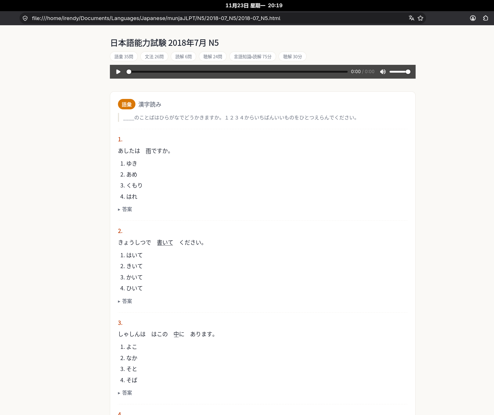
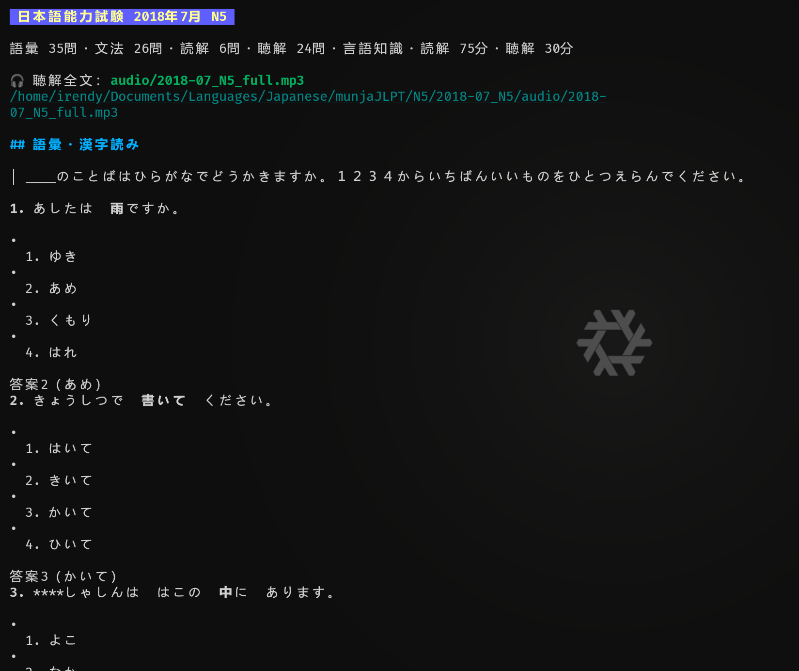
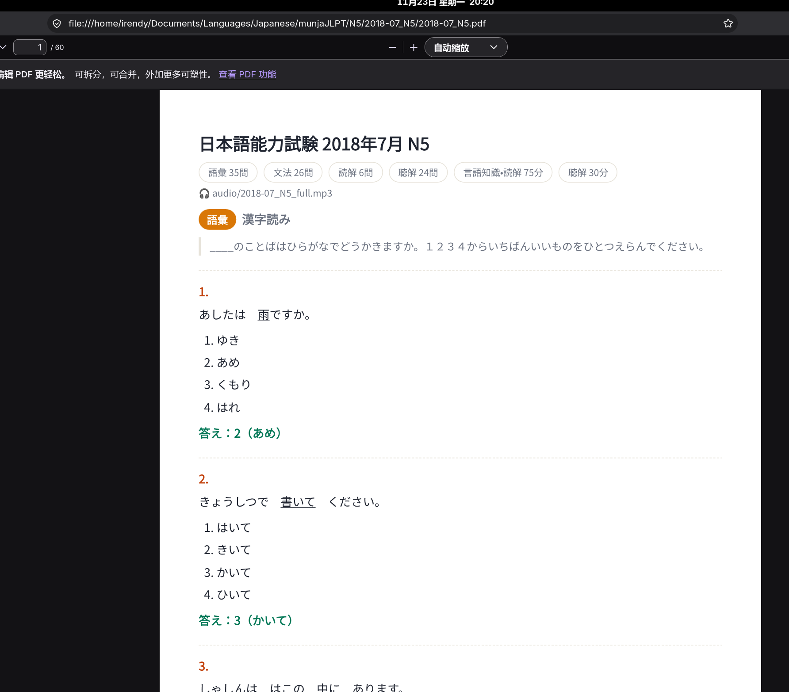

# munja

整理 JLPT（日语能力考试）试题：把试卷 JSON 渲染成 **HTML / Markdown / PDF**，输出文件与源 JSON 放于同级目录。用 Rust 编写，单一静态二进制，无运行时依赖。

## 快速上手

```bash
# 1) 构建（产物在 target/release/munja）
cargo build --release

# 2) 生成 N3–N5 全部试卷的 HTML + Markdown（默认格式）
./target/release/munja

# 3) 连 PDF 一起生成
./target/release/munja -f all

# 4) 删除所有生成的 html/md/pdf（不动源 JSON、音频、图片）
./target/release/munja --clean
```

数据默认在 `exam/` 目录（N1–N5），源码在 `src/`，两者分离。

## 试题数据

`exam/` 目录**不随仓库上传**（已在 `.gitignore` 中忽略），试题数据需自行下载。

**下载地址**：

> https://mega.nz/file/Pp4hDaKb#iV2bp99KELdjfUEpUXMfgYkjMBljrzq64ZcjaX2YU88

**数据来源**：[5mdld/anki-jlpt-decks](https://github.com/5mdld/anki-jlpt-decks)

**许可证**：[Attribution-NonCommercial 4.0 International（CC BY-NC 4.0）](https://creativecommons.org/licenses/by-nc/4.0/)——仅限非商业用途，使用请保留署名。

**放置方法**：

1. 下载压缩包并解压；
2. 在项目根目录建 `exam/` 目录，把解压出的 **N1–N5** 放进去；
3. 解压后的目录结构应如下（每个级别一个目录，每张试卷一个子目录，内含 JSON、`audio/`、`images/`）：

```text
munjaJLPT/
├── exam/
│   ├── N1/  N2/  N3/  N4/  N5/
│   │   └── 2010-07_N3/
│   │       ├── 2010-07_N3.json
│   │       ├── audio/   images/
│   │       └── …
├── src/  fonts/  …
```

放好后即可运行 `munja` 生成 HTML / Markdown / PDF。

## 用法

```text
munja [级别|JSON路径...] [选项]
```

**位置参数**（可省略、可多个）：

| 写法                                 | 含义                                    |
| ------------------------------------ | --------------------------------------- |
| （不写）                             | 默认处理 N3、N4、N5                     |
| `N5`                                 | 处理 N5 一个级别                        |
| `N3 N4`                              | 处理 N3 和 N4                           |
| `exam/N5/2010-07_N5/2010-07_N5.json` | 只处理这一份试卷（路径以 `.json` 结尾） |

**选项**：

| 选项                     | 说明                                                                |
| ------------------------ | ------------------------------------------------------------------- |
| `-f, --format <FORMATS>` | 输出格式，逗号分隔：`html` / `md` / `pdf` / `all`（默认 `html,md`） |
| `--answers <MODE>`       | 答案显示：`fold` 折叠（默认）/ `show` 直接显示 / `hide` 不输出      |
| `--browser <PATH>`       | 浏览器可执行文件（生成 PDF 用，默认自动检测 Edge/Chrome/Chromium）  |
| `--font <PATH>`          | 日文字体文件（HTML 以 @font-face 引用，默认自动查找）               |
| `--data-dir <DIR>`       | 数据根目录（含 N1–N5 子目录，默认 `exam`）                          |
| `--clean`                | 清理模式：删除各试卷生成的 html/md/pdf（不动源 JSON、音频、图片）   |
| `--dry-run`              | 只打印执行计划，不写文件（生成或清理都适用）                        |
| `-q, --quiet`            | 安静模式，只输出错误                                                |

## 示例

### 生成

```bash
# 默认：N3–N5 的 HTML + Markdown，答案折叠
munja

# 全部格式（HTML + Markdown + PDF）
munja -f all

# 只要 PDF
munja -f pdf

# 只要 Markdown
munja -f md

# 指定级别
munja N5
munja N3 N4 -f html,md

# 指定单份试卷
munja exam/N5/2010-07_N5/2010-07_N5.json -f all

# 答案直接显示 / 完全不输出答案
munja -f html --answers show
munja -f html --answers hide

# 只看会生成哪些文件，不真正写入
munja --dry-run
```

### 清理

```bash
# 预览将删除哪些文件（不真正删除）
munja --clean --dry-run

# 删除所有级别生成的 html/md/pdf
munja --clean

# 只删除 N5
munja --clean N5
```

> `--clean` 只删除「与试卷 JSON 同目录、同文件名」的 `.html` / `.md` / `.pdf`，
> 源 JSON、`audio/`、`images/` 一概不动。

### PDF 与字体

```bash
# 手动指定浏览器（找不到 Edge/Chrome 时）
munja -f pdf --browser "/path/to/msedge.exe"

# 手动指定字体文件
munja -f pdf --font "/path/to/SourceHanSansSC-Regular.otf"

# 使用非默认数据目录
munja --data-dir ./my-data -f all
```

## 目录结构

数据与源码分离：所有试卷数据集中在 `exam/`，源码在 `src/`。

```text
munjaJLPT/
├── exam/                 # ← 试卷数据（只读，生成产物也在此）
│   ├── N1/ … N5/         #   每个级别一个目录
│   │   └── 2010-07_N3/   #   一张试卷一个目录
│   │       ├── 2010-07_N3.json
│   │       ├── 2010-07_N3.html / .md / .pdf   # 生成的产物
│   │       ├── audio/  images/
├── fonts/                # 打包字体（供 HTML/PDF 引用）
├── src/                  # Rust 源码
├── Cargo.toml
└── build-windows.sh
```

## 输出

每个试卷目录内（与 JSON 同级）生成同名文件：

```text
exam/N3/2010-07_N3/
├── 2010-07_N3.json          # 源数据（只读）
├── 2010-07_N3.html          # 内嵌 CSS + <audio> 音频，零 JS，答案 <details> 折叠
├── 2010-07_N3.md            # 听解含音频路径 + 完整原文，下划线考点转粗体
├── 2010-07_N3.pdf           # 无头浏览器打印 HTML 生成（含打印分页样式）
├── audio/ … images/ …
```

HTML 特性：

- 头部含级别、题型统计、考试时长、听解全文音频
- 每道听解题内嵌 `<audio controls>` 播放器 + 完整听写原文 + 配图
- 阅读/语法题渲染文章原文（含下划线、表格、邮件等格式）
- 答案用原生 `<details>` 折叠，零 JS；`@media print` 打印样式（分页、隐藏播放器、显示音频文件名、展开答案）

## 预览

三种格式的实际效果：

**HTML** —— 内嵌音频播放器 + 折叠答案，浏览器直接打开即可用：



**Markdown** —— 音频路径 + 完整听写原文，下划线考点转粗体：



**PDF** —— 打印排版，含分页样式，字体嵌入、跨平台一致：



## PDF 说明

- PDF 由无头浏览器打印 HTML 生成，**浏览器自动检测顺序**：
  - Windows：Edge（Win10+ 自带）→ Chrome（Program Files 与 LOCALAPPDATA）
  - macOS：Chrome → Edge → Chromium
  - Linux：microsoft-edge → google-chrome → chromium 等（PATH 查找）
- 找不到时用 `--browser` 指定路径，或安装 Chromium/Edge。
- 中间 HTML 会保留在同目录（与 `--format html` 输出一致，可直接浏览器打开）。

## 字体

保证各平台 PDF 排版一致：优先 `<data_dir>/fonts/` 下的静态日文字体，
找不到再回退系统字体（Windows 的 Yu Gothic / MS Gothic，macOS 的 Hiragino，Linux 的 Noto / IPA）。

```bash
# 把任意日文/中文黑体放进 fonts/ 即可（推荐思源黑体/Noto Sans CJK Regular 静态版）
mkdir -p fonts
cp /path/to/SourceHanSansSC-Regular.otf fonts/
```

> ⚠️ 不要用 `NotoSansCJK-VF.otf.ttc` 这类**变量字体集合**：Chromium 无头打印会误选
> Thin 实例导致笔画过细。用静态 Regular 字重文件。

## 构建

```bash
cargo build --release          # 产物: target/release/munja
```

## 项目结构

```text
src/
├── main.rs        # 入口：装配 CLI → 扫描 → 探测浏览器/字体 → 流水线
├── cli.rs         # 命令行定义（clap）
├── model.rs       # 试题数据模型（serde，兼容单题/组题/null、选项与身份字段的多种类型）
├── source.rs      # 扫描加载 JSON（级别目录 或 单个 JSON 文件）+ 清理生成文件
├── browser.rs     # 无头浏览器探测 + HTML→PDF 打印
├── font.rs        # 日文字体查找（显式 → fonts/ → 系统路径 → fc-match）
├── text.rs        # HTML 清理 / 转义 / HTML→Markdown 转换
├── pipeline.rs    # 试卷 × 渲染器调度、dry-run、失败收集
└── render/
    ├── mod.rs     # Renderer trait + 渲染上下文 + 组装
    ├── html.rs    # HTML 渲染器
    ├── markdown.rs# Markdown 渲染器
    └── pdf.rs     # PDF = HtmlRenderer + 浏览器打印
```
